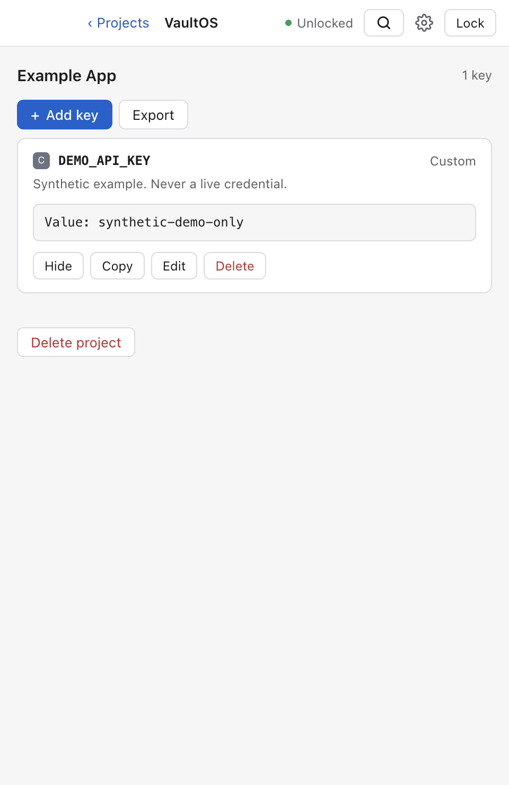

# VaultOS

**Your project secrets, on your Mac. Give coding agents the access they need.**

VaultOS is a local desktop vault with an MCP bridge. Organize credentials by project, approve an agent's projects and output folders, and let it write a working environment file without returning the secret values in its tool response.

[Download the macOS preview](https://github.com/rohit3a/vaultos/releases) · [Agent setup](docs/AGENTS.md) · [Security model](SECURITY.md) · [Contribute](CONTRIBUTING.md)

> **Unsigned preview:** early software for evaluation, without Developer ID signing or Apple notarization. Start with test credentials and keep independent backups. Security regression tests are included; this project has not received an independent security audit.



## Why use it?

- **Fewer secrets in chat.** `inject_secrets` writes approved keys to an approved file; its response contains names and counts, not values. Revealing a value requires a separate, off-by-default permission.
- **A human controls access.** Enroll and revoke individual agents. Choose their projects, output directories, and scopes. Agents cannot widen their own permissions.
- **Protect existing credentials.** Human-owned entries require explicit delegation before an agent can edit them. Agent-created credentials start awaiting approval for injection.
- **Local by default.** No account, hosted vault service, telemetry, or automatic cloud upload. Password remembering is optional and uses macOS Keychain or the Linux Secret Service, without a plaintext fallback.
- **Practical daily tools.** A menu bar item, a Quick Access panel (⇧⌘Space) to find and copy a key from any app, search across every project, expiry metadata, short-lived clipboard copies, encrypted PDF export, password rotation, encrypted backups, and guarded undo.
- **A full password manager too.** Logins, API keys, notes, SSH keys, databases, servers and certificates with tags, favorites and custom fields; one-time codes; a password and passphrase generator; a Trash and archive; per-item versions; encrypted attachments; Watchtower for weak, reused, old and expiring secrets with an opt-in breach check; and import from 1Password, Bitwarden and CSV.
- **Optional encrypted sync.** Use a separate Git repository with age encryption, pinned peer signing identities, tamper checks, and explicit conflict acceptance.

Injection reduces accidental disclosure in tool transcripts. **It does not stop an agent with filesystem or shell access from reading the resulting file.** VaultOS is not an operating-system sandbox or an enterprise access-control service. Read the [threat model](SECURITY.md) before deciding what to store.

## Install on macOS

1. Download the ZIP and matching `.sha256` from the [preview release](https://github.com/rohit3a/vaultos/releases). Choose `arm64` for Apple Silicon or `x64` for Intel. The deployment target is macOS 13 or later; see release notes for versions actually tested.
2. In the download folder, run `shasum -a 256 -c <download-name>.zip.sha256` and confirm `OK`. This checks file integrity; it does not authenticate a publisher independently of GitHub.
3. Extract **VaultOS.app** and put it in a folder of your choice. It can coexist with other vault applications.
4. Try opening it. If macOS blocks the unidentified developer, follow Apple's [per-app Open Anyway instructions](https://support.apple.com/en-us/102445) in **System Settings → Privacy & Security**, only after you have verified and decided to trust the download. Managed Macs may disallow this. Do not disable Gatekeeper globally.
5. Create a new vault using a unique passphrase of at least 12 characters. Optionally add a Secret Key, which the device keeps and a stolen vault file cannot be opened without. There is no password reset or recovery service.

The app is a small native program (Rust, with the system's own web view for its pages). The MCP bridge (`vaultos-mcp`), the agent shell client (`vaultos-agent`), the recovery CLI (`vaultos`) and the headless owner (`vaultosd`) ship inside it, in `VaultOS.app/Contents/Helpers`. Git is needed only for optional sync. A vault from VaultOS 0.2 opens only to be upgraded, when you choose **Upgrade this vault**; read [Upgrading from 0.2](docs/RECOVERY.md#upgrading-from-02) first.

### First five minutes

Create an **Example App** project and add a disposable credential. In **Settings → Agents**, enroll your coding tool with `read` and `inject`, select that project, and approve its project folder. Save the one-time token in a private file and follow [MCP setup](docs/AGENTS.md). Ask the agent to inject the chosen key into that folder's `.env`; check the application works without asking it to print the file.

Use **Lock** when finished. While the desktop is running, Lock, system sleep, screen lock, or 15 minutes without a privileged desktop action stop the local API and clear the decrypted application state. Closing the window locks the vault the same way. On macOS VaultOS then stays in the menu bar, locked, until you reopen it, unlock Quick Access, or choose **Quit VaultOS**; turn the menu bar item off in **Settings** to quit when the window closes. Optional opt-in settings change this posture: background access with the always-on service ([background access](docs/AGENTS.md#background-access)) keeps agents served after the window closes, until a Lock, screen lock, sleep or idle lock blocks it; a soft lock policy keeps agents served while the Mac is locked; autosync keeps [Git sync](docs/SYNC.md) running in the background, and on Macs with Touch ID (with background access on) **Settings → Touch ID** can unlock the window and confirm reveals, exports, approvals and agent changes with a fingerprint, falling back to the master password. Read [SECURITY.md](SECURITY.md) before enabling them.

### Menu bar and Quick Access

The menu bar item shows whether the vault is locked, how many agent records await approval, and sync health, and opens Quick Access, the window, Lock and Settings. Press **⇧⌘Space** anywhere to open Quick Access: type part of a key, project, username or website, then **⏎** copies the value, **⌘C** the username, **⌘O** opens the website and **⌘⏎** shows the key in VaultOS. Quick Access never receives values; the main process copies them. In the window, **⌘K** searches every project. **Settings → Menu bar & Quick Access** changes the shortcut, turns the menu bar item off, opens VaultOS at login (in the menu bar, locked) and turns on notifications for pending approvals and expiring keys. On Linux the tray icon is off by default (**Settings → Tray & Quick Access**), works only where the desktop shows tray icons, and the shortcut is **Ctrl+Shift+Space**.

## Install on Linux

Linux support is a preview with less testing than macOS. The app needs the system's WebKitGTK 4.1 and, for the tray icon, libayatana-appindicator3. Releases include an x64 tarball; from a source checkout, install it with `scripts/install-linux.sh --from <download-name>.tar.gz`, which checks the `.sha256` beside it. To build instead (x64 or arm64, this machine's architecture), install Rust, Node.js 22+ and, on Debian/Ubuntu, `libwebkit2gtk-4.1-dev libayatana-appindicator3-dev librsvg2-dev libxdo-dev`:

```sh
npm run dist:linux          # dist/vaultos-preview-linux-<arch> and a tar.gz
scripts/install-linux.sh    # installs to ~/.local/opt/vaultos-preview (--prefix to change)
```

The installer adds an app-menu entry and does not use root. Optional password remembering uses the Secret Service through `secret-tool` (package `libsecret-tools` on Debian/Ubuntu, `libsecret` on Fedora) and a running keyring such as GNOME Keyring. Without them, background access is unavailable; there is no plaintext fallback. `--enable-service` also installs and starts a systemd user unit that runs the installed app as the background service. It is never enabled by default and still unlocks only after you enable background access in Settings. Screen lock is read from logind, which most screen lockers update.

## Storage and recovery

Preview data lives in `~/Library/Application Support/VaultOS-Preview` on macOS and `~/.config/VaultOS-Preview` (or `$XDG_CONFIG_HOME/VaultOS-Preview`) on Linux, with a separate `org.vaultos.preview` Keychain or Secret Service namespace. It does not automatically import older applications' data, tokens, sync repositories, or Keychain entries. `VAULTOS_DATA_DIR` can select an **absolute, new directory** for testing.

Back up with `vaultos backup` (or copy `vault.enc`) and keep its password, and its Secret Key if it has one. Sync keys are inside the vault; the sync index beside it is part of the backup. Read [backup, recovery, migration, and uninstall](docs/RECOVERY.md) before using real credentials.

## Run from source

Install Rust with rustup (it fetches the toolchain pinned in `rust-toolchain.toml`), Node.js 22+ for the build and test scripts, and on macOS the command-line developer tools:

```sh
git clone https://github.com/rohit3a/vaultos.git
cd vaultos
npm start                # a debug build of the desktop
```

Tests use temporary synthetic vaults.

```sh
cargo test --workspace
npm run check
npm run test:desktop     # macOS with an interactive desktop
npm run dist:mac         # unsigned app for this Mac's architecture
VAULTOS_ARCH=x64 npm run dist:mac
npm run dist:linux       # unsigned Linux tar.gz, on Linux for its own architecture
```

See [development and release instructions](CONTRIBUTING.md), [architecture](docs/ARCHITECTURE.md), and [optional sync](docs/SYNC.md).

## Give your agent the instructions

Point an agent at [AGENTS.md](AGENTS.md) or ask it to read
[skills/vaultos/SKILL.md](skills/vaultos/SKILL.md). The skill covers macOS and Linux
installation, MCP connection, grants, daily secret operations, updates,
backups, and troubleshooting.
For clients supporting Agent Skills, install the complete `skills/vaultos/` folder
using the client's skill installation mechanism; keep its `references/` directory.
Clients supporting named skill invocation can then use `$vaultos`.

Example request: “Use the VaultOS skill to connect this agent to my preview vault
with read and inject access to my project.” The skill provides instructions; the
human still unlocks the vault and grants access in the desktop. It contains no
credentials and does not automatically change client configuration.

## Project status

This first public preview prioritizes a small, inspectable local workflow. Remaining release milestones include independent security review, Developer ID signing and notarization, broader macOS/Intel runtime coverage, accessibility review, and usability improvements to conflict resolution. No automatic updater is enabled; install future releases explicitly after backing up.

Built and maintained by [@rohit3a](https://github.com/rohit3a). Contributions, reproducible bug reports using synthetic data, and security review are welcome. Licensed under [MIT](LICENSE); dependencies retain their own licenses.
